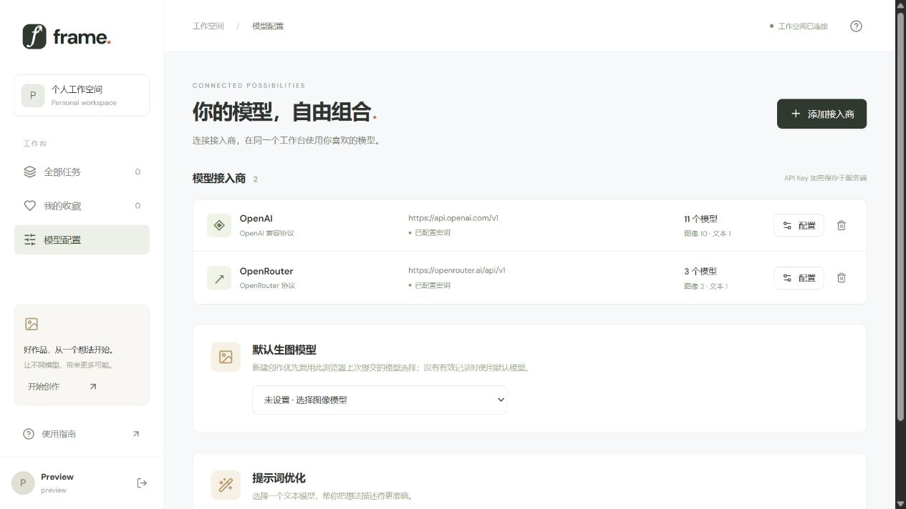
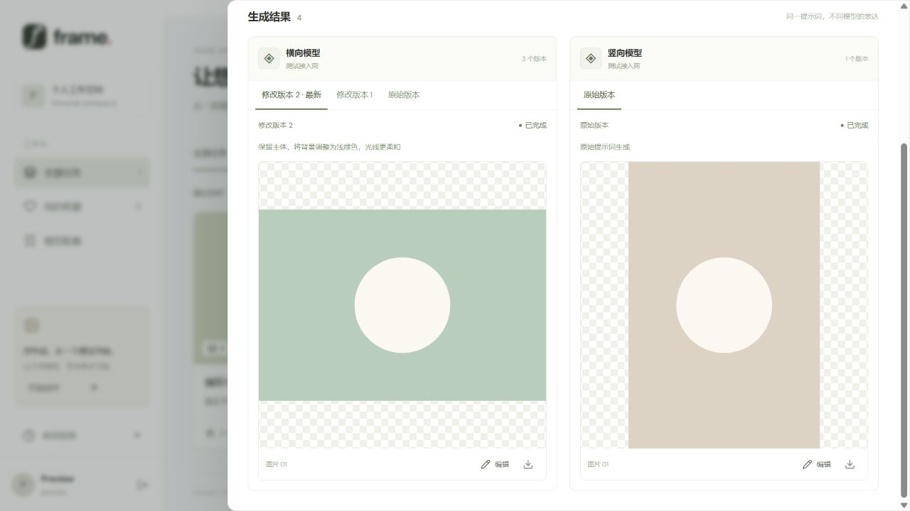

<div align="center">

# Frame · 图片生成工作台

**留一点空间，给想象。**

在一个安静、简洁的工作台里，连接模型、比较画面、持续修改。

[](https://github.com/liubaicai/openAIImage/actions/workflows/ci.yml)
[](LICENSE)
[](https://nodejs.org/)
[](https://github.com/liubaicai/openAIImage/pkgs/container/openaiimage)

[快速开始](#快速开始) · [界面预览](#界面预览) · [模型接入](#模型接入) · [部署配置](#部署配置) · [版本发布](#版本发布)

</div>


> 截图来自开发期间的体验/测试模式，展示示例素材与模拟数据，不代表模型实际生成质量、费用或账号配置。当前版本首次进入需设置管理员，不开放注册或访客入口。

## 让创作保持简单

| 能力 | 使用体验 |
| --- | --- |
| **多模型对比** | 一次最多选择 10 个生图模型，分别展示状态与结果，失败可单独重试。 |
| **持续修改** | 发送原始提示词、所选图片和修改要求；版本以 Tab 切换，最新修改优先展示，卡片尺寸稳定。 |
| **自由接入** | 支持 OpenAI 兼容协议和 OpenRouter；从接入商目录选择模型，按 ID 搜索、筛选图像或文本模型。 |
| **费用预估** | OpenRouter 提交前显示各模型与合计 USD 预算；按明确计费单位估算，未知费用不会被当成免费。 |
| **记住习惯** | 配置默认生图模型；浏览器优先复用上次成功提交的选择，参数未变时复用已计算的估价。 |
| **提示词优化** | 选择文本模型后启用优化，先预览建议，再决定是否应用。 |
| **作品管理** | 搜索、筛选、收藏、网格/列表切换、原图预览与下载。 |
| **自己掌控数据** | 单管理员、无需邮箱；SQLite 与图片存于本地，API Key 加密保存。 |

## 界面预览

### 模型配置 · 常用模型，一次设好



### 结果对比 · 每次修改，都有迹可循



横图、竖图按比例完整显示；版本通过 Tab 切换，不会逐个向下堆叠。截图中的几何图案是布局测试素材。

## 快速开始

### Docker Compose

需要 Docker Engine 与 Compose 插件。第一次部署可直接从源码构建：

```sh
git clone https://github.com/liubaicai/openAIImage.git
cd openAIImage
docker compose up -d --build
```

打开 **http://localhost:3001**，设置唯一管理员的用户名和密码。无需邮箱，没有预设密码，也没有内置 API Key。

Compose 默认仅将端口映射到宿主机 `127.0.0.1`，数据保存在 `frame-data` 命名卷中。停止容器使用 `docker compose down`；不要加 `-v`，它会删除数据卷。

### 使用发布镜像

首次成功发布版本后，可直接运行 GHCR 镜像：

```sh
docker run -d \
  --name frame \
  --init \
  --restart unless-stopped \
  -p 127.0.0.1:3001:3001 \
  -v frame-data:/app/data \
  ghcr.io/liubaicai/openaiimage:latest
```

支持 `linux/amd64` 与 `linux/arm64`。正式部署建议固定版本标签，如 `:v0.0.1`。更新 Compose 镜像：

```sh
docker compose pull
docker compose up -d --no-build
```

> GitHub 首次创建的 GHCR 包可能是私有的。如果匿名拉取失败，请在包设置中调整可见性，或使用具有 `read:packages` 权限的凭据登录 GHCR。

### 本地开发

使用 Node.js **22.13+ 的 22.x** 或 **24.x**：

```sh
npm ci
npm run dev
```

前端：**http://127.0.0.1:5173** · API：**http://127.0.0.1:3001**

本地生产运行：

```sh
npm run build
npm start
```

生产模式下 API 同源提供前端页面。配置可从 `.env.example` 复制为 `.env`，本地启动命令会自动读取。

## 模型接入

1. 打开 **模型配置 → 添加接入商**，填写协议、Base URL 和 API Key。
2. 获取模型列表，搜索并勾选需要的模型。接入商可选模型数量不设上限；单次创作最多使用 10 个。
3. 选择默认生图模型；如需优化提示词，再选择一个文本模型。
4. 开始创作，填写描述、选择模型与参数，查看预算后提交。
5. 在结果抽屉中对比图片，或基于任一版本继续编辑。

| 协议 | Base URL 示例 | 图片接口 |
| --- | --- | --- |
| OpenAI / 兼容接入商 | `https://api.openai.com/v1` | `/images/generations`、multipart `/images/edits` |
| OpenRouter | `https://openrouter.ai/api/v1` | 专用图像模型 `/images`；通用目录独有模型 `/chat/completions` |

OpenRouter 合并 `/models` 与 `/images/models`，支持同源分页并去重。模型类型优先依据输入/输出模态识别；仅支持理解图片的模型不会因此被判断为生图模型。能力缺失时使用名称推断，已选模型可调整类型和编辑能力。

已有接入商可直接修改名称、调整或删除已选模型并保存，不必重新获取目录。新增模型或更换地址、协议时需要获取目录；更换地址需要重新输入密钥。列表中的模型不一定对当前账号开放，具体参数支持由接入商决定。

### 关于价格预估

- 读取图像端点的明确计费单位，服务端缓存费率 5 分钟；不调用付费接口获取估价。
- 按张/请求计费依据本项目每张一次请求计算；多路由与未确定档位显示区间。
- 像素/token 价格为粗略预算，展开「估算依据」可查看假设；未实现模型专属官方 token 表。
- 实际请求指定画面比例，最终分辨率由模型决定。预算区间不是费用上限，以账单为准。
- 缺失或单位不明的价格显示「费用待确认」；混合模型显示已知小计与未计费用。
- 预估仅覆盖当前新建任务，不包括后续编辑和提示词优化。

## 部署配置

| 变量 | 默认值 | 说明 |
| --- | --- | --- |
| `PORT` | `3001` | API 与生产页面端口 |
| `HOST` | 本地 `127.0.0.1` / 容器 `0.0.0.0` | 监听地址 |
| `DATA_DIR` | 本地 `./data` / 容器 `/app/data` | 数据库、原图和自动生成的主密钥 |
| `SECURE_COOKIES` | `false` | HTTPS 部署时设为 `true` |
| `ENCRYPTION_KEY` | 首次自动生成 | 可显式设置为 64 位十六进制文本，即 32 字节密钥 |
| `WORKER_CONCURRENCY` | `3` | 同时处理的模型请求数，范围 1–8 |
| `ALLOW_PRIVATE_PROVIDERS` | 未启用 | 仅可信私有网关需要时设为 `true` |

容器运行时使用 `docker run -e`、`--env-file` 或 Compose `environment` 传入配置；`.env` 不会复制进镜像。随附 Compose 直接映射 `SECURE_COOKIES` 和 `WORKER_CONCURRENCY`，其他变量按需添加。

**数据持久化。** 挂载整个数据目录，数据库与加密主密钥需一起备份。停机后备份最简单；在线备份应使用 SQLite 一致性备份机制。不要丢失或直接更换主密钥，否则已有 API Key 无法解密。

**单实例运行。** 当前适合个人工作台，使用单进程 SQLite 队列，不要让多个实例共享数据库。重启后未执行任务继续排队，已发出的中断请求标记失败，避免自动重试造成重复计费。

**反向代理。** 公网部署应提供 HTTPS，保留原始 `Host`，并设置 `SECURE_COOKIES=true`。首次管理员初始化请在受控网络内完成。默认只允许公开 HTTPS 接入地址。

**边界。** 当前没有密码找回、多用户权限或分布式队列。支持 PNG、JPEG、WebP 图片结果，不支持专门输出 SVG 的模型。字体使用 Google Fonts，无法访问时回退系统字体。

## 开发与验证

```sh
npm test
npm run build
```

测试使用隔离数据库与模拟接入商，不消耗真实模型额度。覆盖管理员初始化、登录与权限、模型发现、生成/编辑/重试、密钥存储、价格计算及缓存、默认模型与浏览器选择恢复。

```text
src/                React 工作台与浏览器状态
server/             Express API、SQLite、队列、接入协议
shared/             共享类型与价格估算
public/             静态资源
tests/              隔离测试
docs/screenshots/   README 示例截图
.github/workflows/  CI 与版本发布
```

技术栈：**React 19 · TypeScript · Vite · Express 5 · Node.js SQLite**。

## 版本发布

普通分支推送和 Pull Request 自动执行：

1. Node.js 22 / 24 测试与生产构建。
2. Docker 镜像构建、容器启动、初始化 API 与前端页面检查。

推送版本标签后，Release 工作流会先复用上述检查，再发布双架构镜像与 GitHub Release：

```sh
git tag v0.0.1
git push origin v0.0.1
```

正式版本产生 `:v0.0.1`、`:0.0.1`、`:latest`；预发布标签如 `v0.0.2-beta.1` 不覆盖 `latest`。镜像名称为 **`ghcr.io/liubaicai/openaiimage`**，发布说明包含镜像地址及 digest。

使用仓库自带 `GITHUB_TOKEN`，无需额外配置 Docker Hub 密钥；仓库需允许 Actions 运行以及工作流写入 Packages 和 Release。[发布工作流](.github/workflows/release.yml) · [GitHub 容器发布文档](https://docs.github.com/en/actions/tutorials/publish-packages/publish-docker-images)

## 开源与致谢

采用 [MIT License](LICENSE)，允许使用、修改、分发和商用，保留版权与许可声明即可。第三方服务、模型及示例图片仍遵循各自的条款。

价格预估参考 [open_image_playground](https://github.com/liubaicai/open_image_playground) 的计费处理思路，独立实现。感谢 [OpenRouter](https://openrouter.ai/) 与 OpenAI 兼容生态提供模型接入能力。
